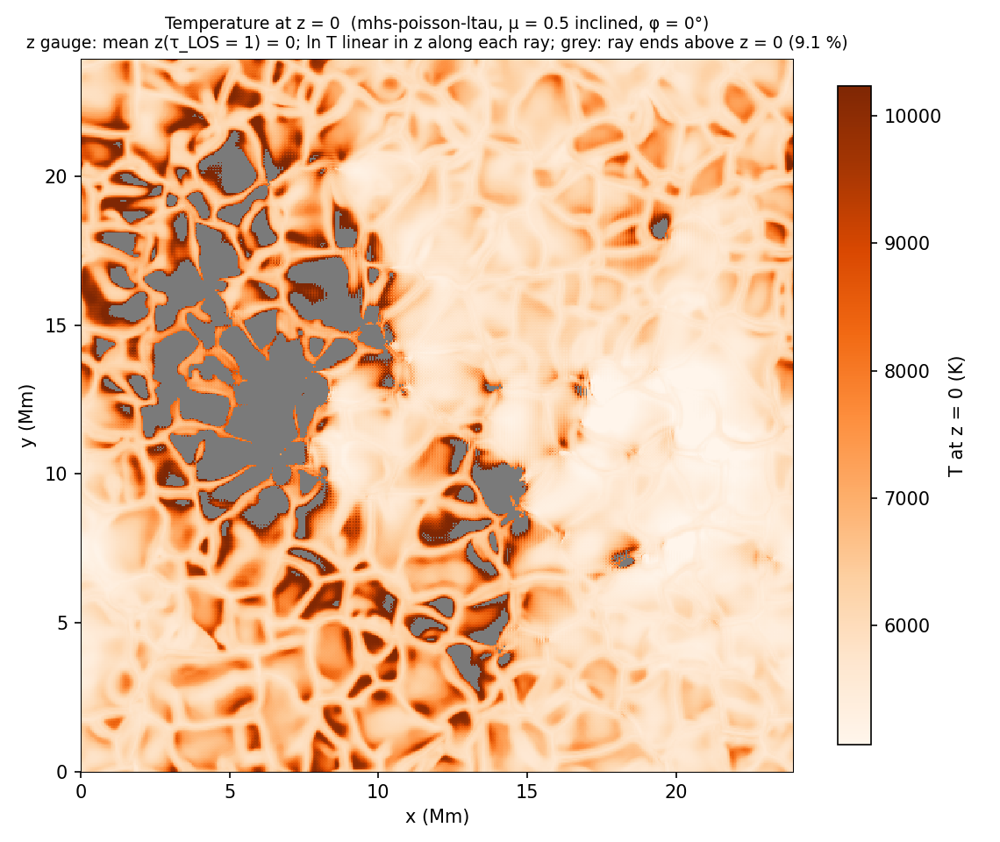
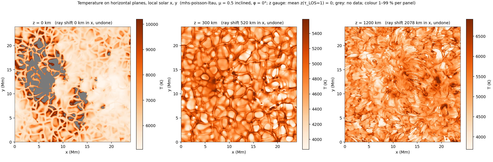
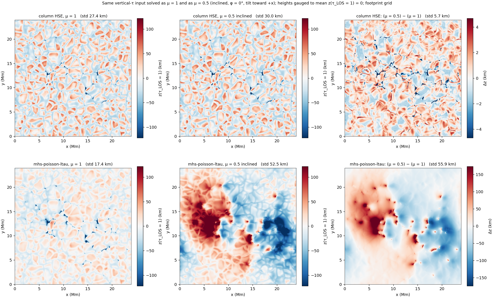

# Viewing angle on a disk-centre τ cube: μ = 0.5 vs μ = 1 (2 Nov 2026)

**Input:** `/mn/stornext/d9/data/harshm/halpha_output/input-mhs-ltau.nc`, 504 × 504 columns, dx = dy = 47.61 km,
95 levels log₁₀ τ₅₀₀ = −8.0 … 1.4. T and B in K and T (|B_z| up to 0.21 T at τ = 1). There are no file attributes, so
`physics.g = 274`.

**The point of this report.** The τ axis of this file is **vertical (μ = 1)**. It was first solved as if it were a
μ = 0.5 line-of-sight cube (`[view] mu = 0.5, geometry = "inclined"`). That run is **invalid for this file**. A μ = 1 run
and two column-HSE runs were then made to check, from intuition, what that mismatch does. The checks confirmed most of
the predictions, but not all of them.

> **Rule for the future.** `view.mu < 1` is only correct when T and B are given on τ counted **along the line of sight
> at that μ**, on footprints at z = 0 (README "Viewing angle", input contract). A cube whose τ was computed vertically
> (any disk-centre / μ = 1 product) must be run with μ = 1. To model an off-centre view of such an atmosphere, build a
> slanted-ray input from the 3-D cube on a height grid first (`scripts/viewing/make_slanted_tau.jl`), because a τ-grid
> file alone has no heights to trace rays through.

## 1. Runs

All runs use `scripts/run.jl` with MPI over hyades nodes (`mpiexecjl -launcher ssh`, `mhs_rank.sh`) and
`source ~/loadgcc.sh`. Exit status 2 means a valid result that stopped at `max_steps` without meeting the stopping rule.

| run | branch / commit | ranks × threads (nodes) | wall | status | Φ₀ → Φ/Φ₀ | z(τ_LOS = 1) p1 / p50 / p99 |
|---|---|---|---|---|---|---|
| MHS μ = 0.5 inclined, first try | `viewing-angle` 4c7e398 + a74b7b9 | 37 × 24 (h4, 5, 10, 15, 18, 20) | stopped at step 11 | – | 1.44e13 → 4.9e-3 | (step 11: −47 / 17 / 128 km) |
| **MHS μ = 0.5 inclined** | `solver-time` 6c6a264 + 9531239 | 37 × 24 (h4, 5, 10, 15, 18, 20) | 653 s (solve 551 s) | 2 (`max_iter`) | 3.52e13 → 3.35e-4 | −124.5 / −3.7 / 156.8 km |
| **MHS μ = 1** | same | 34 × 24 (h4, 5, 6, 10, 18, 20) | 524 s (solve 425 s) | 2 (`max_iter`) | 7.68e10 → 2.14e-2 | −38.1 / −0.4 / 33.4 km |
| column HSE μ = 1 | same | 34 × 24 | 85 s | 0 | – | −38.0 / −5.7 / 60.4 km |
| column HSE μ = 0.5 inclined | same | 8 × 32 (hyades5) | 46 s | 0 | – | −40.2 / −5.7 / 62.9 km |

**MHS solver settings** (`solver-time` defaults + the D2 benchmark set): `logtau_cut = −4` (vertical frame, so the μ = 0.5
cut is at log τ_LOS = −3.70), 25 steps, `lm = "gain"`, `forcing = "ew"`, `precond = "switch"`.
- The μ = 0.5 run switched to column-block preconditioning at step 11.
- Its final GN decrement was 1.22e-3, just above `gn_tol` = 1e-3; μ = 1 ended at 5.7e-2.
- Gauge shifts: 16.8 km (μ = 0.5), 7.2 km (μ = 1).

The first try on `viewing-angle` (old stopping rule, ~24 s per step, α ≈ 0.1–0.25, CG at its cap) was stopped by hand.
Its Φ₀ differs because that branch cuts on the line-of-sight axis and weights Φ differently.

## 2. Coordinates in the inclined geometry (for reading these outputs)

- **x, y, z are local solar coordinates.** z is vertical height, not distance along the ray. It is gauged to mean
  z(τ_LOS = 1) = 0.
- **Each pixel is one straight ray**, labelled by its **footprint** (ξ, η), where it crosses z = 0.
  - Its nodes sit at x = ξ + t_x z, y = η + t_y z, with t = tan θ (cos φ, sin φ). Here t_x = 1.732 and t_y = 0.
  - `coords/x_m`, `coords/y_m` are the footprints. The node positions are not stored.
- **`logtau500` is τ along the ray** (τ_LOS), one common axis for all pixels. `z_m[k, j, i]` is the vertical height of
  level k on ray (i, j). `z_tau1_m` is on the footprint grid.
- **A fixed τ level is not a horizontal plane.**
  - A map at height z is a 1-D interpolation along each ray, giving the footprint map shifted by t z for all rays. Undo it
    with a periodic sub-pixel roll (`scripts/plot_T_planes.py`). At z = 0 there is no shift.
  - A vertical slice or profile at fixed (x, y) crosses a different ray at each height. It needs interpolation across
    rays: (x, z) for φ = 0, (x, y, z) in general.

## 3. The μ = 0.5 result as run (invalid for this file)

**T at z = 0, 300 and 1200 km.** Medians 6131 K, 4729 K and 5155 K; median log τ_LOS at those heights −0.08, −2.14, −5.7.
- **z = 0:** 9.1 % of the rays end above z = 0 (grey). The input reaches only log τ_LOS = 1.4, a median 65 km below
  τ = 1 on these rays. The left half shows hot granules up to 10.5 kK because z = 0 lies deep below the raised τ = 1
  surface there.
- **z = 300 km:** shows reversed granulation.
- **z = 1200 km:** lies above the cut, so its heights come from column HSE only.
- **The large left/right split is an artefact of the μ mismatch** (section 4).

Two other things seen in these outputs:
- The top level (log τ = −8) sits at a median height of 70 Mm, because the input T reaches 1.6 MK there. Don't use the
  top-level heights.
- A cross-correlation test of whether structures at different heights line up after the shift was inconclusive.

## 4. Predictions and checks: the same vertical-τ input solved as μ = 1 and as μ = 0.5

Numbers from `scripts/compare_mu.py`.

**P1: column HSE barely changes with μ, while P(τ) drops to about 0.6–0.7. Confirmed.**
- **Why expected:** with μ = 0.5 a given τ is reached through less mass, so P at τ = 1 falls. Lower P means lower opacity
  per length, which re-stretches the column. The scale height depends only on T, so the spacing in z between τ levels is
  unchanged. The gauge removes the absolute offset.
- **z(τ = 1):** μ = 0.5 − μ = 1 has rms 5.7 km (p1 / p99 −4.4 / 2.9 km), correlation 0.984; std 27.4 vs 30.0 km.
- **Thickness z(log τ −2) − z(log τ 0):** median 290.5 vs 287.7 km, ratio 0.991.
- **P(log τ = 0) ratio μ 0.5 / μ 1:** 0.665 (p1 – p99: 0.655 – 0.674).

**P2: strong-field displacements grow at μ = 0.5 (lower β). True in column HSE, reversed in MHS.**

Mean z(τ = 1) minus the box median, by |B| at log τ = 0:

| \|B\| (G) | n | column HSE μ = 1 | column HSE μ = 0.5 | MHS μ = 1 | MHS μ = 0.5 |
|---|---|---|---|---|---|
| 0 – 200 | 244968 | 6.9 | 7.3 | 1.6 | 3.0 |
| 200 – 500 | 6293 | −12.0 | −13.0 | −12.1 | 11.7 |
| 500 – 1000 | 1560 | −23.6 | −30.2 | −36.6 | 27.8 |
| 1000 – 1500 | 607 | −44.0 | −85.4 | −75.7 | 60.4 |
| > 1500 | 588 | −154.3 | −246.7 | −165.0 | 74.6 |

**P3: the 3-D solve, given vertical columns labelled as slanted, sees spurious horizontal forces and corrugates τ
surfaces much more, with an x (tilt-direction) bias. Partly confirmed.**
- **Fake imbalance: confirmed.** Φ₀ is 460 times larger (3.5e13 vs 7.7e10). The starting horizontal force measure at log τ
  −1 … 0 is 1.30 vs 0.17.
- **More corrugation: confirmed.**
  - z(τ = 1) std is 52.5 km at μ = 0.5 vs 17.4 km at μ = 1. Column HSE gives 27.4 km.
  - So the μ = 1 solve smooths the column-HSE surface, and the μ = 0.5 solve roughens it threefold.
  - The two MHS maps correlate at −0.03.
- **Granule-scale x lopsidedness: not seen.**
  - Correlation of Δz with ∂x z(μ = 1): −0.04; with ∂y: 0.00. With ∂x ln T: −0.01.
  - The 3-pixel autocorrelation of Δz is 0.97 along x and 0.98 along y.
- **What appears instead is one large-scale pattern of ±150 km.**
  - 79 % of the Δz variance survives 2 Mm smoothing; rms 49.6 of 55.9 km.
  - It raises the left half by 28 km and lowers the right half by 28 km. μ = 1 has no such split (−1.7 / +1.7 km).
  - It follows the bipole, laid out along the tilt axis: negative-polarity concentrations centred at x ≈ 8 Mm, positive at
    x ≈ 16 Mm. The smoothed Δz correlates −0.39 with smoothed B_z and +0.29 with |B_z|.
  - Strong-field columns of both polarities are raised (|B_z| > 500 G: B_z < 0 by +177 km, B_z > 0 by +99 km).
  - The mechanism, most likely the slant terms of the Lorentz force acting on a bipole aligned with the tilt, is not
    confirmed.

## 5. Conclusions

1. For this file the valid result is **μ = 1**: `halpha_mu1.h5`, with z(τ = 1) 1st – 99th percentile −38 … +33 km. It
   is budget-limited (25 steps, Φ/Φ₀ 2.1e-2). A longer run, e.g. `max_steps` 35–50, would be needed for a converged
   answer.
2. Treating vertical τ as line-of-sight τ is harmless for **column HSE** (5.7 km rms). It is badly wrong for
   **mhs-poisson-ltau**:
   - about 460 times the initial force imbalance;
   - a threefold rougher τ = 1 surface;
   - a ±150 km large-scale pattern tied to the field layout along the tilt;
   - strong-field depressions turned into elevations.
3. The code behaves as designed. The error was the input contract. A guard is worth adding: a file attribute naming the
   τ frame and μ, checked against `[view]`.

## 6. Operational notes

- **Manifest.** Both `viewing-angle` and `solver-time` listed ProgressMeter in `Project.toml` but not in `Manifest.toml`,
  so `Pkg.instantiate` failed. Fixed and pushed on both branches (2 Nov 2026).
- **Cluster worktrees** (`/mn/stornext/d9/data/harshm/`), IO and `HSEMHS/cache` symlinked:
  - `MHS_viewangle`, on branch `viewing-angle`;
  - `MHS_solvertime`, detached at `solver-time`, where these runs were made.
- **hyades10** had no node-local Julia; `/tmp/julia-1.13.1` was rsynced from hyades4.
- **hyades15** was swapped for hyades6 for the μ = 1 run because another user was on it.
- **StorNext stall.** The first column-HSE μ = 0.5 run stalled in its cooperative HDF5 write: one rank sat in
  uninterruptible I/O (state D) on hyades4. It was killed and rerun on hyades5 alone. Its partial file is kept as
  `invalid/halpha_colhse_mu05_partial.h5` and is **incomplete; do not use it**.

## 7. Files

In this folder:
- `configs/`: the TOML of every run (`viewingangle_*` = the first try);
- `logs/`: solver output, filtered to the solver lines;
- `scripts/compare_mu.py`: the section 4 numbers and the comparison figure;
- `scripts/plot_T_planes.py`: the plane T maps;
- `figs/`.

Data (about 1.35 GB each) in `/mn/stornext/d9/data/harshm/MHS/HSEMHS/out/mu_mismatch_2026-11-02/` (moved there from
`MHS_solvertime/HSEMHS/out/modes/` on 2 Nov 2026), with the full unfiltered run logs, launch scripts and host files in
`logs/` and the run TOMLs in `configs/`. On the cluster, `data/` in this folder links to them (not in git):

| file | content |
|---|---|
| `halpha_mu1.h5` | **MHS μ = 1 (valid)** |
| `halpha_mu05_inclined.h5` | MHS μ = 0.5 inclined (input mismatch) |
| `halpha_colhse_mu1.h5` | column HSE μ = 1 |
| `halpha_colhse_mu05b.h5` | column HSE μ = 0.5 inclined |
| `invalid/halpha_colhse_mu05_partial.h5` | incomplete (stalled write), ignore |
| `halpha_mu05_inclined_T_z0.h5` | T and log τ_LOS at z = 0 from the μ = 0.5 run |

All `tau_grid` outputs: `/tau_grid/{logtau500, z_m, Pgas, rho, T, Bx, By, Bz, z_tau1_m}`, `/coords/{x_m, y_m}`; h5py
order (τ, y, x); run status in the file attributes (`status`, `stop_reason`, `phi_start`, `phi_end`, `view_*`, `work_*`).
